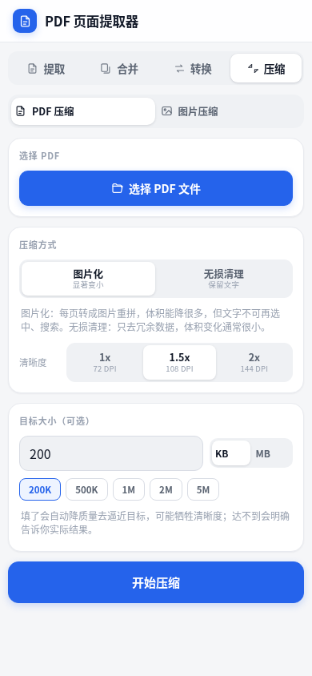
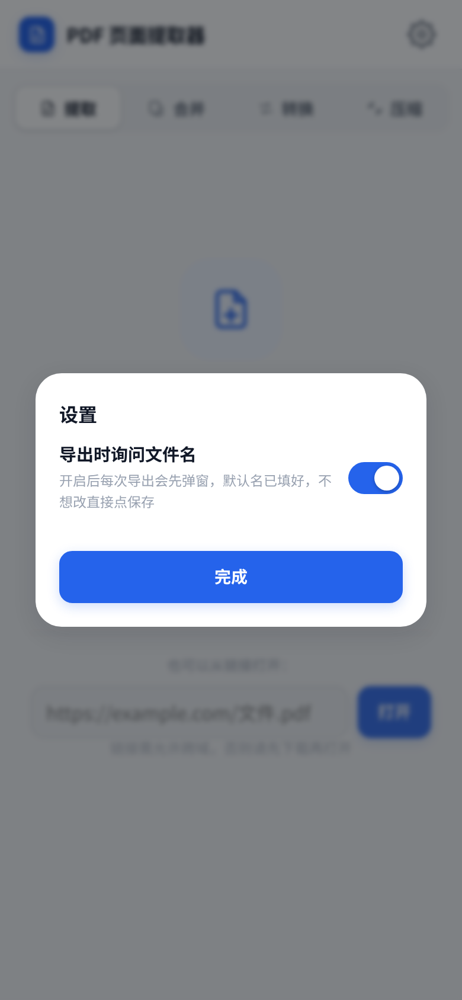
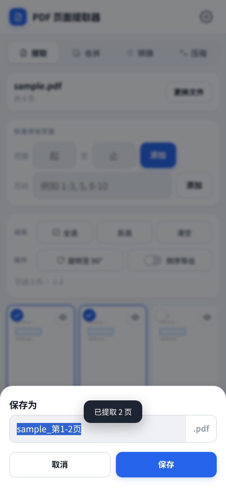

<!-- Hero -->
<div align="center">


# 📄 PDF Page Extractor

### Android app · Single-file web build · Fully offline · Files never leave your device

Select, extract, split, merge, convert and compress PDFs — **everything runs on your device, nothing is uploaded**.

[](https://github.com/AATINF/pdf-page-extractor/releases)
[](https://github.com/AATINF/pdf-page-extractor/releases/latest)
[](LICENSE)

<br>

<a href="https://github.com/AATINF/pdf-page-extractor/releases/latest/download/pdf-page-extractor.apk"></a>
&nbsp;
<a href="https://github.com/AATINF/pdf-page-extractor/releases/latest/download/pdf-page-extractor.html"></a>
&nbsp;
<a href="README.md"></a>

</div>

---

## 📱 Android App

A real APK, not a web wrapper — **works with airplane mode on**, and files never leave the device.

| | |
|---|---|
| **Version** | v1.5.0 |
| **Size** | 1.6 MB |
| **Requires** | Android 7.0 (API 24) or later |
| **Permissions** | Only one: `INTERNET` (see below) |
| **Download** | [pdf-page-extractor.apk](https://github.com/AATINF/pdf-page-extractor/releases/latest/download/pdf-page-extractor.apk) |

### Install

1. Open the download link in your phone browser;
2. Tap the APK, allow "install from unknown sources" **for this one time**;
3. A blue document icon appears on your home screen.

Upgrades install **over the top** — the signing key is fixed, so you never need to uninstall first.

### About the permission list

Many people get worried by the long list in system settings. Here is the reality:

| What you see | What it actually is |
|---|---|
| Auto-start / Linked start / Floating window / Lock screen display / Background pop-up | **Fixed entries in the OEM management page** — shown for nearly every app, off by default, unrelated to this app |
| Sensors (device motion) | WebView listening for screen orientation |
| Clipboard read/write | Built into the WebView engine; this app never calls it |
| **Local network** | A real permission, coming from `INTERNET` |

The APK's `AndroidManifest.xml` declares only two:

- `INTERNET` — Android's WebView requires the network stack even to load local pages; **the app code makes no network requests**
- `WRITE_EXTERNAL_STORAGE` (`maxSdkVersion=28`) — only for saving files on Android 9 and below; Android 10+ uses MediaStore

To verify: turn on **airplane mode** after installing — everything still works.

### App-specific features

- Extract → **saves into the system Downloads folder**, then shows a result card with the full path
- The result card offers **Open** (system PDF reader) and **Share** (WeChat / mail / cloud drive)
- Hardware back button: closes dialogs first, then clears selection, then exits
- Dark mode follows the system
- UI rebuilt for phones: segmented controls, 44px touch targets, safe-area insets, 3-column thumbnails

<div align="center">
  
  
  
  <br>
  <sub>Home · Selection & toolbar · Save result</sub>
</div>

---

## ✨ Features

| Module | What it does | Notes |
|---|---|---|
| **📂 Load** | File picker / drag & drop / URL | Encrypted PDFs prompt for a password |
| **👁 Thumbnails** | Grid of all pages | 3 columns on phones, lazy-rendered |
| **☑ Page selection** | Tap / range input / page list | Supports `2-5`, `1-3,5,8-10` |
| **🔍 Preview** | Zoom, rotate, page through | 0.4x–4x |
| **📑 Extract to PDF** | Selected pages → new PDF | **Vector text preserved**; encrypted PDFs are rasterized |
| **✂️ Split to single pages** | One PDF per page → ZIP | |
| **🧩 Merge PDFs** | Combine in order | Reorder or remove files |
| **🔄 Rotate** | +90° per selected page | **Thumbnails update immediately**; button shows the next angle |
| **↕️ Reverse order** | Output back-to-front | Toggle switch |
| **🔒 Encrypted PDFs** | Password + rasterized output | 144 / 216 DPI, JPEG or PNG |
| **💾 Native save** (App) | Writes to system Downloads | Open or share right after saving |
| **🖼️ PDF → images** | Export each page as PNG / JPEG | 1x / 2x / 3x, ZIP for multi-page |
| **📄 Images → PDF** | Combine multiple images | Reorder, A4 or original size, three margin levels |
| **🗜️ PDF compression** | Rasterize / lossless cleanup | Target file size supported; 3.04 MB → 999 KB measured |
| **🖼️ Image compression** | Quality / max side / target size | Batch processing |
| **⚙️ Settings** | Gear icon in the header | Currently one option: ask for filename on export |
| **✏️ Rename on export** | Optional, off by default | Pre-filled name, base name selected, extension locked |

---

## 🔄 Convert & Compress

All four modes share the same rendering pipeline and run entirely on-device.

### PDF → images

Pick a PDF, choose format and resolution, export. Multiple pages are packed into a ZIP automatically.

| Option | Choices |
|---|---|
| Format | JPEG (smaller) / PNG (lossless) |
| Resolution | 1x / 2x / 3x — 72 / 144 / 216 DPI |
| Range | All pages, or the pages selected in the Extract tab |

### Images → PDF

Select multiple images, reorder them, generate. Portrait images use A4 portrait, landscape images switch to A4 landscape automatically; "original size" keeps the source aspect ratio.

### Compression

| Method | Best for | Trade-off |
|---|---|---|
| **Rasterize** | Scans, image-based PDFs | Text is no longer selectable or searchable |
| **Lossless cleanup** | Text PDFs | Usually only 5–15% smaller |

**Target file size**: enter a number in KB or MB and the app iterates up to 6 rounds — dropping resolution first when the gap is large (file size scales with the square of resolution), then quality when it is close. If the target cannot be met, the result tells you exactly what it produced.

> Measured: 25 pages / 3.04 MB → **999 KB (67% smaller)**; target 300 KB, actual output **300 KB**.

> ⚠️ Rasterizing a **text-based** PDF makes it **larger** (e.g. 5.6 KB → 103 KB). The app detects this and falls back to lossless cleanup or the original file, with an explanation.

<div align="center">
  
  
  
  <br>
  <sub>PDF → images · Images → PDF · PDF compression</sub>
</div>
---

## ⚙️ Settings

Open with the gear icon in the top-right corner. One option for now:

| Option | Default | Behaviour |
|---|---|---|
| **Ask for filename on export** | Off | Every export first shows a "Save as" dialog: the generated name is pre-filled, the **base name is pre-selected**, and the extension (`.pdf`/`.zip`/`.jpg`) is locked so it cannot be broken. Cancelling aborts the export entirely |

- Settings are stored locally and survive app restarts
- Batch exports (split pages, PDF → images) only ask for the **archive** name; files inside keep their automatic names
- Off by default, so nothing changes for users who just want it to work

---

## 🎬 Demos

> All recorded from real browser sessions — not motion graphics. The phone UI matches the Android app.

### ① Select pages and extract

Load a PDF → thumbnails render → tick pages 2 and 4 → tap Extract → `sample_第2,4页.pdf` downloads.

<div align="center">
  
  <br><sub><a href="assets/demo.mp4">📹 MP4 (78 KB)</a></sub>
</div>

### ② PDF to images

Switch to Convert → pick a PDF → choose 3x (216 DPI) → export; multiple pages are zipped automatically.

<div align="center">
  
  <br><sub><a href="assets/demo_convert.mp4">📹 MP4 (80 KB)</a></sub>
</div>

### ③ Compress to a target size

Switch to Compress → pick a PDF → tap the "500K" preset → start; the app iterates toward the target automatically.

<div align="center">
  
  <br><sub><a href="assets/demo_compress.mp4">📹 MP4 (118 KB)</a></sub>
</div>

---

## 🖼️ More screens

<div align="center">
  
  
  
  <br>
  <sub>Dark mode · Encrypted PDF export settings · Compression target size</sub>
</div>

<div align="center">
  
  
  
  <br>
  <sub>Settings · Rename on export · Landscape layout</sub>
</div>

---

## 🚀 Quick start

| Method | Use case | How |
|---|---|---|
| **Android app** (recommended) | Everyday phone use | [Download the APK](https://github.com/AATINF/pdf-page-extractor/releases/latest/download/pdf-page-extractor.apk), install, works offline |
| **Single-file build** | Desktop, tablet, any browser | Download `pdf-page-extractor.html` and double-click it |
| Multi-file | PWA / further development | Open `index.html` through an HTTP server |
| LAN | Phone accessing files on a PC | `python3 serve.py`, then open the printed URL |

> 💡 **Single-file download**: [get it here](https://github.com/AATINF/pdf-page-extractor/releases/latest/download/pdf-page-extractor.html) — 2 MB, copy it anywhere, **no install and no network required**.

---

## 🔐 Privacy: why this beats online tools

Tools like ilovepdf or smallpdf **must upload your file to their servers** before they can do anything — contracts, résumés and scanned IDs all pass through someone else's disk.

Everything here happens on your device. There is no upload step at all.

| | Online tools | **This app** |
|---|---|---|
| File upload | ❌ Required | ✅ **Never leaves the device** |
| Network required | ❌ Always | ✅ Works offline (verify with airplane mode) |
| Permissions | Often a dozen or more | ✅ Only `INTERNET` |
| Privacy risk | High | ✅ Minimal |
| Large / sensitive files | Discouraged | ✅ Fine |
| Cost | Limited free tier | ✅ Free and open source |

---

## 🧱 Tech stack

No backend, no accounts, no analytics.

**Web layer**

- **PDF.js** (Apache-2.0) — parsing, rendering, thumbnails, rasterized output
- **pdf-lib** (MIT) — page copy, rotation, new PDF generation (vector path)
- **JSZip** (MIT) — ZIP packaging for split pages

**Android shell**

- **Capacitor 8** — packs `www/` into the APK; the WebView serves local assets from `https://localhost`
- **Custom native plugin `FileSaver`** — Android WebView ignores `<a download>` with `blob:` URLs, so saving must go native:
  - Android 10+: MediaStore writes into the system Downloads folder, no runtime permission
  - Android 7–9: legacy external storage path + `WRITE_EXTERNAL_STORAGE`
  - Also exposes `share()` (`ACTION_SEND`) and `openFile()` (`ACTION_VIEW`)

Library copyright notices are kept in the headers of files under `lib/`; please do not remove them when redistributing.

---

## 🛠 Development

```bash
# Web build
python3 tools/build.py            # inline the PDF.js worker into index.html
python3 tools/build_single.py     # produce the single-file build (version injected automatically)

# Android (requires Node 20+, JDK 17+, Android SDK)
npm install
python3 tools/prepare_www.py      # whitelist-copy runtime assets into www/
npx cap sync android
cd android && ./gradlew assembleRelease
```

**Tests**

```bash
python3 tools/check_layout.py        # 21 layout assertions
python3 tools/shots.py               # phone-viewport screenshots
python3 tools/test_convert.py        # 14 e2e assertions for convert & compress
python3 tools/test_settings.py       # 14 e2e assertions for settings & rename
python3 tools/check_apk.py x.apk     # verify APK signing certificate
```

**CI**: `.github/workflows/android.yml` builds on manual dispatch or a `v*` tag (JDK 21 + Node 22) and attaches the APK to the release.

---

## 📖 Docs

- 🎨 [Design baseline](DESIGN.md) — colours, type scale, spacing, component rules *(中文)*
- 📱 [Android implementation plan](PLAN-Android.md) — technical choices, phases, risks *(中文)*
- 📘 [User tutorial (visual)](教程.html) *(中文)*
- 📗 [Detailed usage](README-使用说明.md) *(中文)*
- 🛠 [Developer guide](开发指南.md) *(中文)*
- 📝 [Changelog](CHANGELOG.md)
- 🌐 [中文 README](README.md)

---

## 🔮 Roadmap

- [ ] **Zero-permission APK** — load via `file://` and drop `INTERNET` so the permission list is completely clean
- [ ] **DeepSeek Harness plugin** — expose the core engine as a DSH tool  \
  → [AATINF/pdf-extractor-dsh-plugin](https://github.com/AATINF/pdf-extractor-dsh-plugin)
- [ ] English UI inside the app
- [ ] Memory optimisation for very large documents (300+ pages)

---

## 📄 License

[MIT License](LICENSE) © 2026 AATINF
