<!-- Hero -->
<div align="center">

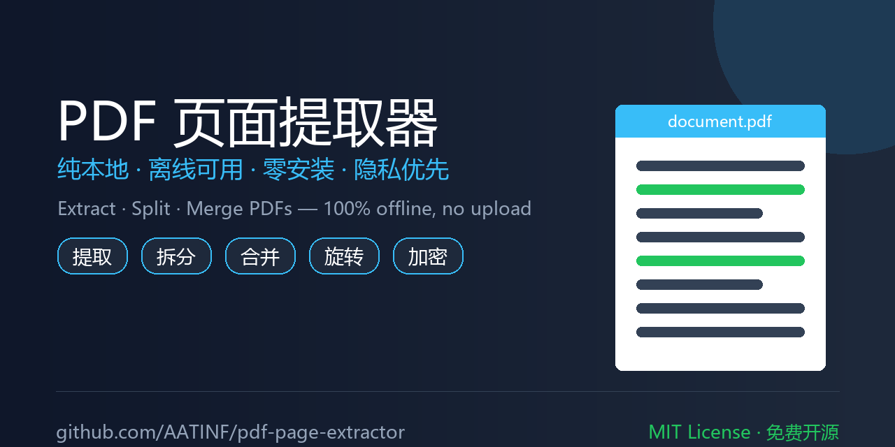

# 📄 PDF 页面提取器

### 安卓 App · 单文件网页版 · 全程离线 · 文件不出本机

在手机或浏览器里选页、提取、拆分、合并 PDF，**所有处理都在你的设备上完成，文件从不上传**。

[](https://github.com/AATINF/pdf-page-extractor/releases)
[](https://github.com/AATINF/pdf-page-extractor/releases/latest)
[](LICENSE)

<br>

<a href="https://github.com/AATINF/pdf-page-extractor/releases/latest/download/pdf-page-extractor.apk"></a>
&nbsp;
<a href="https://github.com/AATINF/pdf-page-extractor/releases/latest/download/pdf-page-extractor.html"></a>
&nbsp;
<a href="README.en.md"></a>

</div>

---

## 📱 安卓 App

真安装包，不是套壳网页——**装完断网也能用**，文件只进不出。

| | |
|---|---|
| **版本** | v1.2.1 |
| **大小** | 3.9 MB |
| **系统要求** | Android 7.0（API 24）及以上 |
| **权限** | 只有 1 个：`INTERNET`（见下方说明） |
| **下载** | [pdf-page-extractor-v1.2.1.apk](https://github.com/AATINF/pdf-page-extractor/releases/latest/download/pdf-page-extractor.apk) |

### 安装

1. 手机浏览器打开上面的下载链接；
2. 下载完成后点击安装，系统提示「未知来源」时选择**允许这一次**；
3. 装好后桌面会出现蓝色图标。

升级时**直接覆盖安装即可**，不用先卸载——签名固定，后续版本都能直接覆盖。

### 关于权限：为什么系统里看到那么多开关？

很多人第一次进设置会被吓到，实际情况是：

| 你在设置里看到的 | 真相 |
|---|---|
| 自启动 / 关联启动 / 悬浮窗 / 锁屏显示 / 后台弹出界面 | **手机厂商管理页的固定展示项**，几乎所有 App 都会出现，默认关闭，与本应用无关 |
| 传感器（访问设备动作与方向） | WebView 内核对屏幕方向事件的监听 |
| 剪贴板读写 | WebView 内核自带，本应用代码中没有任何剪贴板调用 |
| **本地网络** | 这是真权限，来自 `INTERNET` |

APK 的 `AndroidManifest.xml` 里实际只声明了两个：

- `INTERNET` — 安卓的 WebView 加载页面（即使是本地页面）必须走网络栈，这是框架要求，**代码里没有任何联网请求**
- `WRITE_EXTERNAL_STORAGE`（`maxSdkVersion=28`）— 只给 Android 9 及以下保存文件用；Android 10+ 走 MediaStore，不需要它

想验证的话：装好后开**飞行模式**，全流程照样能跑。

### 安卓版特性

- 选页 → 提取 → **保存到系统「下载」目录**，完成后弹出结果卡片，显示完整路径
- 结果卡片支持**直接打开**（调系统 PDF 阅读器）和**分享**（微信 / QQ / 邮件 / 网盘）
- 物理返回键：先关弹窗，再清选中，最后才退出
- 深色模式跟随系统
- 界面按手机重做过：分段控件、44px 触控区、安全区适配、3 列缩略图

<div align="center">
  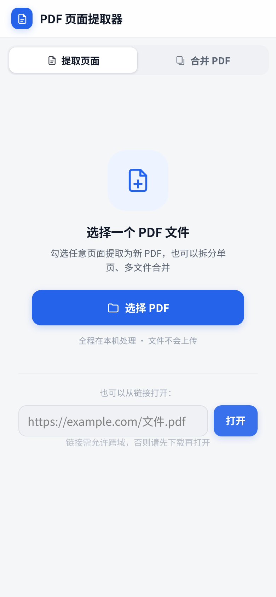
  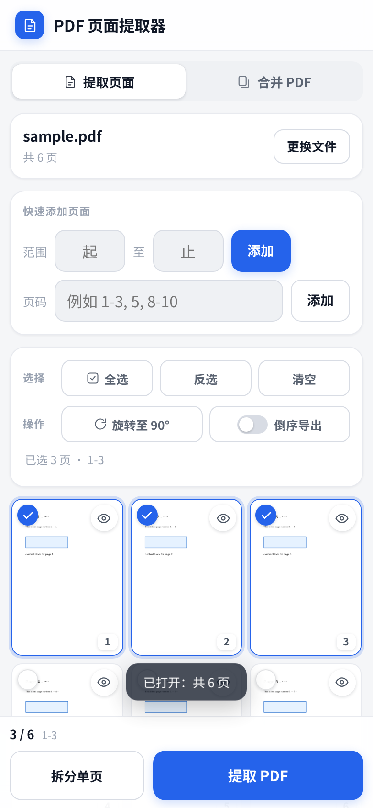
  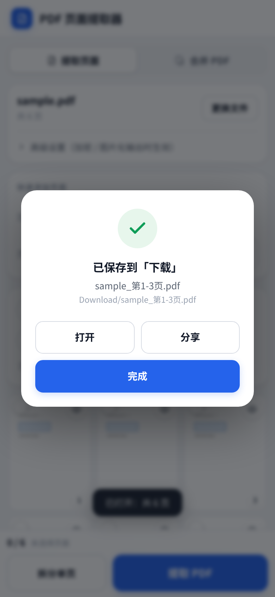
  <br>
  <sub>首页 · 选页与工具条 · 保存结果</sub>
</div>

---

## ✨ 功能一览

| 模块 | 功能 | 说明 |
|---|---|---|
| **📂 文档载入** | 文件选择 / 拖拽 / URL 打开 | 加密文档自动弹密码框 |
| **👁 缩略图浏览** | 全文档缩略图网格 | 手机 3 列，逐页懒加载渲染 |
| **☑ 页面选择** | 点选 / 范围输入 / 组合页码 | 支持 `2-5`、`1-3,5,8-10` 等格式 |
| **🔍 全屏预览** | 缩放 + 旋转 + 翻页 | 0.4x~4x，可左右滑动切页 |
| **📑 提取为 PDF** | 所选页面 → 新 PDF | 普通文档**保留矢量文字**；加密文档自动转图片 |
| **✂️ 拆分为单页** | 每页独立 PDF → ZIP | 一键拆分打包 |
| **🧩 合并 PDF** | 多文档按序合并 | 可多选添加、上移下移、移除 |
| **🔄 旋转页面** | 选中页追加 90° | **旋转后缩略图实时更新**，按钮显示下一步角度 |
| **↕️ 倒序导出** | 按页码倒序排列 | 开关控制，导出时生效 |
| **🔒 加密 PDF** | 密码打开 + 图片化输出 | 清晰度可选 144 / 216 DPI，格式可选 JPEG / PNG |
| **💾 原生保存**（App） | 写入系统「下载」目录 | 完成后可直接打开或分享 |
| **🖼️ PDF → 图片** | 每页导出为 PNG / JPEG | 1x / 2x / 3x 三档清晰度，多页打 ZIP |
| **📄 图片 → PDF** | 多张图片合成 PDF | 可排序、A4 或原尺寸、三档边距 |
| **🗜️ PDF 压缩** | 图片化 / 无损清理 | 图片化可指定目标大小，实测 3.04MB → 999KB |
| **🖼️ 图片压缩** | 质量 / 边长 / 目标大小 | 批量处理，自动逼近目标体积 |

---

## 🔄 转换与压缩

四个模式共用一套渲染管线，全部在本机完成。

### PDF → 图片

选 PDF → 选格式与清晰度 → 导出。多页自动打包 ZIP，单页直接给图片。

| 选项 | 说明 |
|---|---|
| 格式 | JPEG（体积小）/ PNG（无损） |
| 清晰度 | 1x / 2x / 3x，对应 72 / 144 / 216 DPI |
| 范围 | 全部页面，或「提取」模式里已勾选的页面 |

### 图片 → PDF

多选图片 → 可上下调整顺序 → 生成。竖图用 A4 竖版、横图自动切横版；也可选「原图尺寸」保留原始比例。

### 压缩

| 方式 | 适用 | 代价 |
|---|---|---|
| **图片化** | 扫描件、图片型 PDF | 文字不可再选中、搜索 |
| **无损清理** | 文字型 PDF | 体积通常只降 5%~15% |

**目标大小**：填一个 KB 数，会自动迭代 6 轮逼近——差距大时优先降分辨率（体积对分辨率是平方关系），差距小时只降质量。达不到会明确告诉你实际结果。

> 实测：25 页 / 3.04 MB → **999 KB（省 67%）**；目标 300 KB，实际输出 **300 KB**。

> ⚠️ 文字型 PDF 图片化后**反而会变大**（例如 5.6 KB → 103 KB）。程序会检测这种情况并自动回退到无损清理或原文件，同时在提示里说明原因。

<div align="center">
  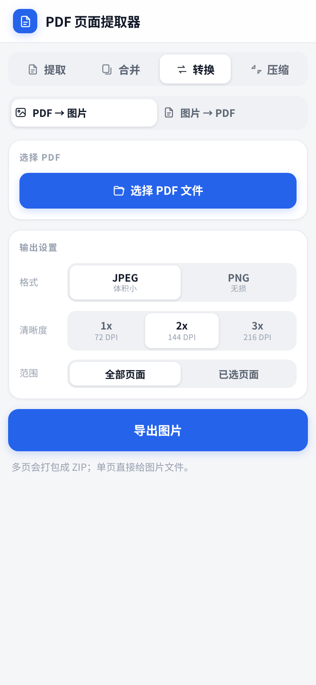
  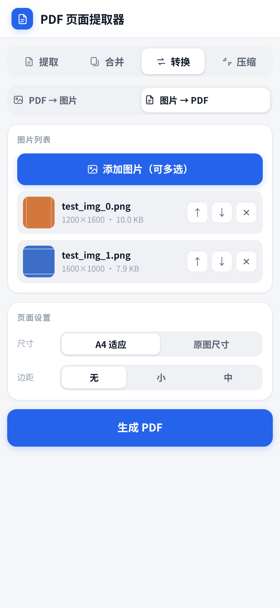
  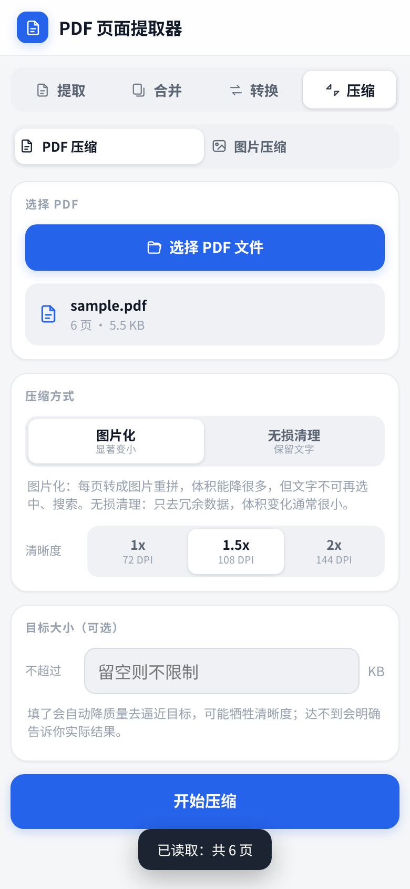
  <br>
  <sub>PDF → 图片 · 图片 → PDF · PDF 压缩</sub>
</div>

---

## 🎬 网页版演示（真实 Edge 浏览器录制）

> 所有演示均为**真实浏览器操作录屏**，非动画示意。

### ① 提取指定页面

加载 PDF → 渲染缩略图 → 勾选第 2、4 页 → 点击「提取为 PDF」→ 浏览器自动下载。

<div align="center">
  
  <br><sub><a href="assets/demo.mp4">📹 高清 MP4 版</a></sub>
</div>

### ② 全屏预览 + 缩放 + 旋转

点击眼睛图标进入预览 → 放大查看细节 → 旋转页面确认方向 → 关闭返回。

<div align="center">
  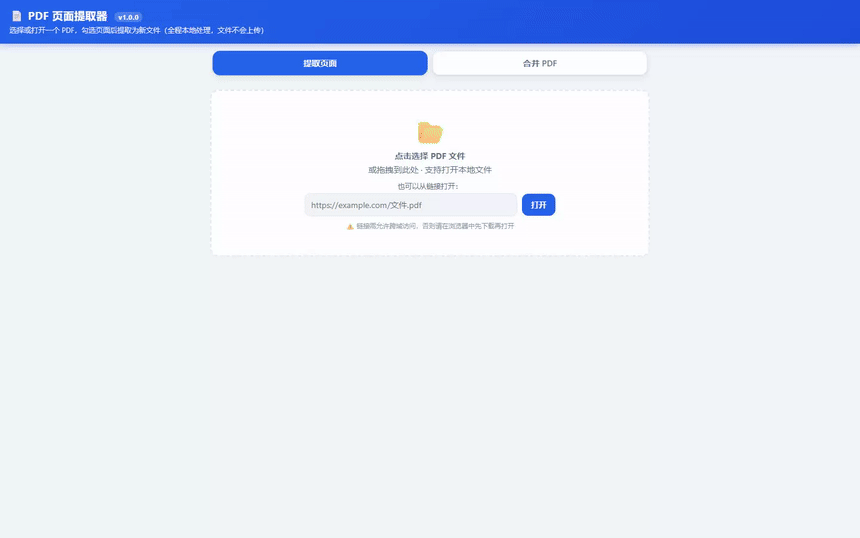
  <br><sub><a href="assets/demo4_preview.mp4">📹 高清 MP4 版</a></sub>
</div>
---

## 🖼️ 更多界面

<div align="center">
  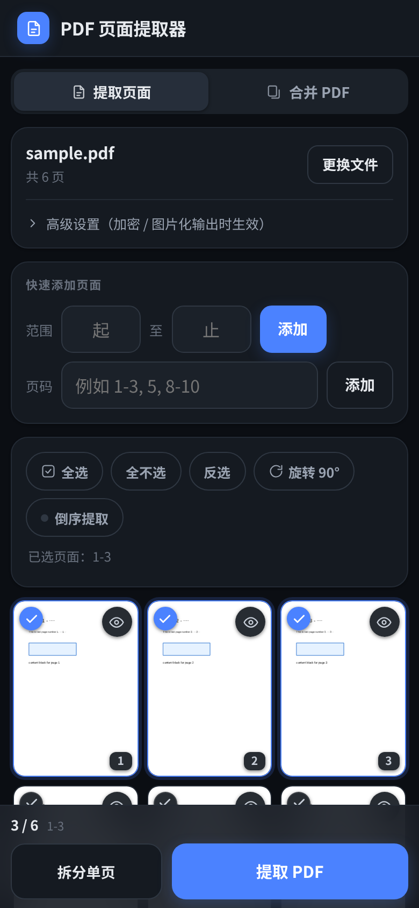
  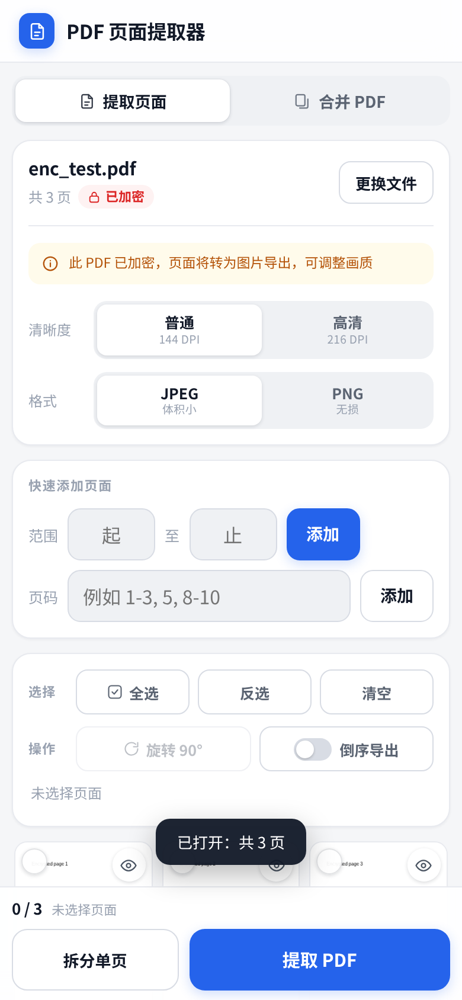
  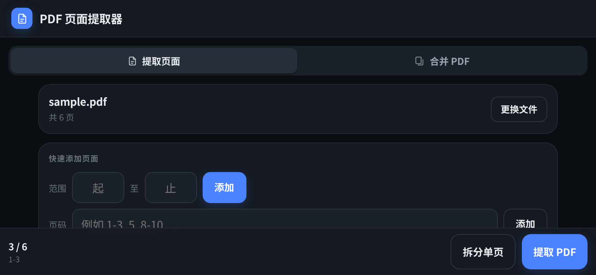
  <br>
  <sub>深色模式 · 加密 PDF 的导出设置 · 横屏布局</sub>
</div>

---

## 🚀 快速开始

| 方式 | 适用场景 | 做法 |
|---|---|---|
| **安卓 App**（推荐） | 手机日常使用 | [下载 APK](https://github.com/AATINF/pdf-page-extractor/releases/latest/download/pdf-page-extractor.apk) 安装，离线可用 |
| **单文件版** | 电脑、平板、任何浏览器 | 下载 `pdf-page-extractor.html`，双击打开即用 |
| 多文件版 | 想当 PWA / 二次开发 | 浏览器打开 `index.html`（需经 HTTP 服务器） |
| 局域网 | 手机访问电脑上的文件 | `python3 serve.py`，手机打开打印出的地址 |

> 💡 **单文件版下载**：[点此获取](https://github.com/AATINF/pdf-page-extractor/releases/latest/download/pdf-page-extractor.html)，2 MB，拷到哪都能用，**无需安装、无需联网**。

---

## 🔐 隐私：为什么比在线工具安全

ilovepdf、smallpdf 这类「在线 PDF 工具」**必须先把文件上传到对方服务器**才能处理——合同、简历、证件扫描件都在别人的磁盘上过一遍。

本工具全部处理都在你的设备内完成，**没有任何上传环节**。

| 对比项 | 在线工具 | **本工具** |
|---|---|---|
| 文件是否上传 | ❌ 必须上传 | ✅ **永不离开设备** |
| 是否必须联网 | ❌ 必须 | ✅ 断网可用（App 可直接开飞行模式验证） |
| 安装包权限 | 视情况，常见十多项 | ✅ 仅 `INTERNET` 一项 |
| 隐私风险 | 高 | ✅ 极低 |
| 大文件 / 敏感文件 | 不建议 | ✅ 适合 |
| 费用 | 限次数 / 付费 | ✅ 完全免费、开源 |

---

## 🧱 技术架构

纯前端处理，无后端、无账号、无埋点。

**网页层**

- **PDF.js**（Apache-2.0）— 解析、渲染、缩略图、图片化输出
- **pdf-lib**（MIT）— 页面复制、旋转、新 PDF 生成（矢量路径）
- **JSZip**（MIT）— 单页拆分打包

**安卓壳**

- **Capacitor 8** — 把 `www/` 打进 APK，WebView 以 `https://localhost` 加载本地资源
- **自定义原生插件 `FileSaver`** — 安卓 WebView 不支持 `<a download>` + `blob:`，文件保存必须走原生：
  - Android 10+：MediaStore 写入系统「下载」目录，免运行时权限
  - Android 7–9：传统外部存储路径 + `WRITE_EXTERNAL_STORAGE`
  - 另提供 `share()`（`ACTION_SEND`）与 `openFile()`（`ACTION_VIEW`）

第三方库的版权声明保留在 `lib/` 文件头部，重分发请勿删除。

---

## 🛠 开发与构建

```bash
# 网页版
python3 tools/build.py            # 内联 PDF.js worker 到 index.html
python3 tools/build_single.py     # 生成单文件版（版本号自动注入）

# 安卓（需要 Node 20+、JDK 17+、Android SDK）
npm install
python3 tools/prepare_www.py      # 白名单复制运行时资源到 www/
npx cap sync android
cd android && ./gradlew assembleRelease
```

**测试**

```bash
python3 tools/check_layout.py     # 21 项布局断言（无溢出/触控尺寸/深色模式…）
python3 tools/shots.py            # 手机视口截图
python3 tools/test_file_protocol.py  # file:// 协议可用性
python3 tools/check_apk.py x.apk  # 校验 APK 签名证书
```

**CI**：`.github/workflows/android.yml` — 手动触发或打 `v*` tag 时构建，JDK 21 + Node 22，APK 自动挂到 Release。

---

## 📖 文档

- 🎨 [设计基线 DESIGN.md](DESIGN.md) — 颜色/字号/间距/组件规范，改界面前先看这个
- 📱 [安卓版实施计划](PLAN-Android.md) — 技术选型、阶段划分、风险清单
- 📘 [使用教程（图文 HTML）](教程.html) — 面向普通用户
- 📗 [详细使用说明](README-使用说明.md)
- 🛠 [开发指南 / 代码复刻](开发指南.md)
- 🌐 [English README](README.en.md)
- 📝 [更新日志](CHANGELOG.md)

---

## 🔮 规划

- [ ] **零权限版 APK** — 改用 `file://` 加载并移除 `INTERNET`，让系统权限列表彻底干净
- [ ] **DeepSeek Harness 插件** — 把核心能力封装为 DSH 工具  \
  → [AATINF/pdf-extractor-dsh-plugin](https://github.com/AATINF/pdf-extractor-dsh-plugin)
- [ ] 应用内英文 UI 切换
- [ ] 大文件（>300 页）的内存优化

---

## 📄 License

[MIT License](LICENSE) © 2026 AATINF
